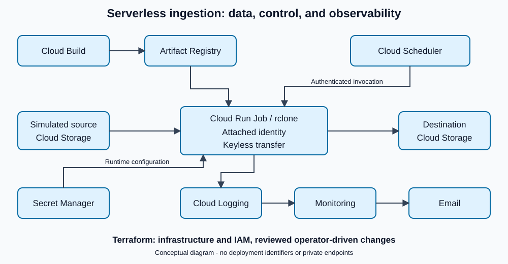

# Cloud Data Architecture Portfolio

**Architecture, engineering decisions, and verified outcomes.**

I am a Principal Data Architect focused on cloud data integration,
infrastructure automation, and observable orchestration. This portfolio shows
how I approach the boundaries between data movement, identity, deployment,
and operational recovery.

## Featured work

| Project | Problem and contribution | Technologies | Status |
|---|---|---|---|
| [Serverless ingestion orchestration](projects/ingestion-orchestration/README.md) | Designed and validated a scheduled transfer workflow with keyless execution, failure notifications, and operator-driven infrastructure drift repair | GCP, Terraform, rclone, containers | E2E-validated demonstration |
| [RAG orchestration engine](projects/rag-orchestration-engine/README.md) | Designed a hybrid retrieval and grounded-answer workflow with disposable cloud runtime, repeatable integration tests, and explicit validation boundaries | Python, LangGraph, PostgreSQL, pgvector, Gemini, OpenAI, GCP, Terraform | E2E query and CI verified; case study published; cloud closeout pending |

**Next:** a Python/Dagster ETL project that builds on reusable ingestion patterns.
This is planned work, not an implemented or validated capability.

## Engineering focus

- **Architecture:** separate the data plane, execution control, configuration,
  and observability responsibilities.
- **Identity:** distinguish runtime access from deployment privileges and avoid
  long-lived execution keys.
- **Operations:** test failure and recovery paths, not only successful transfers.
- **Infrastructure:** use declared configuration and reviewed plans to detect and
  repair out-of-band changes.
- **Evidence:** distinguish measured demonstration results from production claims.

## Explore the case studies

- [RAG project overview](projects/rag-orchestration-engine/README.md)
- [RAG architecture](projects/rag-orchestration-engine/architecture.md)
- [RAG decisions and tradeoffs](projects/rag-orchestration-engine/decisions.md)
- [RAG validation results](projects/rag-orchestration-engine/validation.md)
- [Project overview](projects/ingestion-orchestration/README.md)
- [Architecture](projects/ingestion-orchestration/architecture.md)
- [Decisions and tradeoffs](projects/ingestion-orchestration/decisions.md)
- [Validation results](projects/ingestion-orchestration/validation.md)

## Portfolio boundary

This repository is a documentation-only showcase. Implementation is maintained
privately; a technical walkthrough is available on request.

There are no deployable applications, infrastructure templates, credentials, or
operational runbooks here. Results describe an isolated demonstration, not a
production certification or guaranteed service level.

## Contact

**James White** · Principal Data Architect

[jwhite-dataarchitect on GitHub](https://github.com/jwhite-dataarchitect)

[james.white.cloudarchitect@proton.me](mailto:james.white.cloudarchitect@proton.me)

See [LICENSE](LICENSE) for documentation and diagram usage terms.
