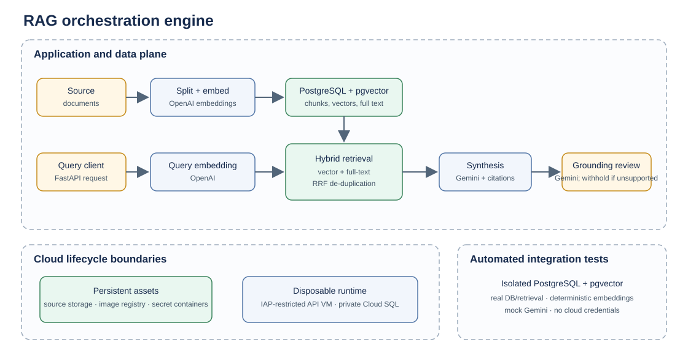

# RAG orchestration engine

**Status as of October 14, 2026:** E2E query validated in an isolated cloud
demonstration; incremental ingestion and rehydration-only recovery are
implemented, and CI passed on the recovery change. The case study and diagram
are published. Final disposable-network teardown and cloud drift validation
remain open.

## The problem

Build a reproducible retrieval-augmented generation (RAG) demonstration that
combines semantic and lexical retrieval, produces cited answers from retrieved
evidence, and withholds answers that fail a separate grounding review. The
runtime should be inexpensive to recreate and safe to tear down without deleting
the durable source and build assets.

## My contribution

I designed and integrated the document processing and retrieval path, the
sequential agent graph and API, the PostgreSQL/pgvector data model, and separate
disposable and persistent infrastructure layers. I also added an isolated
database-backed integration-test stack and a CI workflow that run without cloud
credentials or paid model calls.

## Architecture summary

Documents are split into chunks and embedded before idempotent storage in
PostgreSQL. At query time, the API embeds the question, retrieves candidates
using vector similarity and PostgreSQL full-text search, fuses the ranked lists,
and asks Gemini to synthesize an answer from numbered excerpts. A separate
Gemini review checks the answer against those excerpts; unsupported answers are
withheld.

The cloud demonstration used one IAP-restricted VM for the API and private-IP
Cloud SQL for PostgreSQL. The local Compose stack and the disposable cloud
runtime are separate environments. Persistent source and image assets are
separated from the runtime so the compute and database can be destroyed
independently.

## Demonstrated outcomes

- Database migrations and application startup succeeded in the cloud runtime.
- Health checks succeeded locally and through IAP.
- One non-sensitive provider-backed query completed retrieval, synthesis, and
  grounding with a supported verdict.
- Offline unit tests and Docker-backed PostgreSQL integration tests passed;
  the integration flow uses deterministic embeddings and mocked Gemini calls.
- The October 12 GitHub Actions run for implementation commit `f2c31eb` passed
  36 unit and 3 integration tests. The October 14 GitHub Actions run for recovery
  commit `9ff66d2` also passed both test targets.
- The approved teardown removed the VM and Cloud SQL instance. Google Cloud
  delayed deletion of the private-service networking connection, so final
  disposable Terraform-state cleanup remains pending.

## Scope and access

This is a demonstration, not a production service, benchmark, or guarantee of
answer correctness. Grounding is model-based review, not independent proof of
truth. The router remains a placeholder, ingestion has no automatic schedule,
and the integration suite does not test a separately deployed API container or
live provider calls.

The current splitter uses 512-character chunks and 64-character overlap by
default, not token-based limits or quality-tuned thresholds. Sample seeding
loads prewritten passages rather than exercising that splitter. Content-hash
upserts prevent duplicate rows; an embedding cache is not implemented.

Cloud demo ingress is restricted to IAP, but the API has no application-level
authentication or authorization; local development is also unauthenticated.
Use only non-sensitive demo data. Queries are sent to OpenAI for embeddings,
and queries plus retrieved document text are sent to Google Gemini for
synthesis and grounding. The application does not detect or redact PII.
Application authentication, authorization, and privacy controls are required
before broader or production use.

Decision 12 uses `make recover` to rebuild indexed documents from the current
GCS source objects after database recreation and migrations. This is not a
database snapshot: overwritten or deleted source objects cannot be recovered,
and unrelated database state is not restored. Recovery requires GCS read
access and OpenAI embeddings; GCS behavior is tested with mocks, not against a
live bucket.

The API VM had IAP-only inbound access but an external IP for outbound package
and model access. This is not a private-only network or an application-auth
design. Persistent cloud assets may continue to incur cost; the budget is
notification-only, not a spending cap. The disposable runtime is currently
offline.

Implementation is maintained privately. This repository contains architecture
and validation evidence only; it omits project identifiers, endpoints,
credentials, Terraform state, plans, and operator-specific configuration.

See [the remaining decisions and closeout checklist](decisions.md#remaining-decisions-and-work)
for unresolved items; publication does not close those implementation or
validation gaps.

Continue to [architecture](architecture.md), [decisions](decisions.md), and
[validation](validation.md), or return to the [portfolio](../../README.md).
