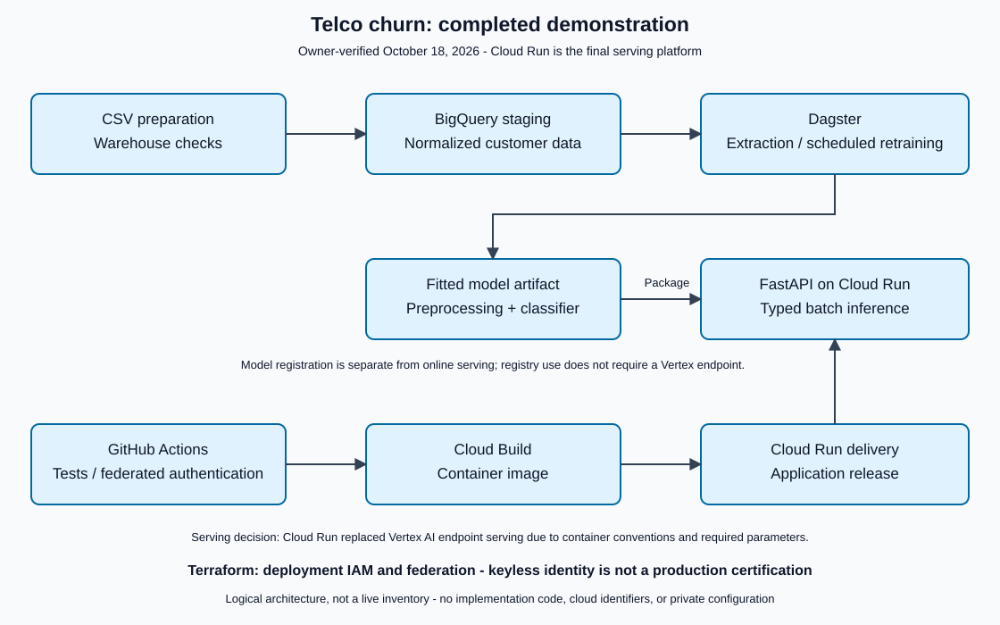

# Architecture

This describes the completed demonstration confirmed by the project owner on
October 18, 2026. It is a logical architecture, not a current cloud-resource
inventory or an assertion that every resource is Terraform-managed.

## Data plane

CSV preparation normalizes customer fields and loads BigQuery staging.
Warehouse checks cover key integrity, numerical nulls, target labels, and
service consistency. The owner confirmed the preparation and validation flow.

Batch staging replacement is not an incremental ingestion or exactly-once
guarantee. Source ownership and recovery remain important operating concerns.

## Model lifecycle

Training selects 19 ordered features and a binary target, splits training and
test data, and fits imputation, scaling, categorical encoding, and logistic
regression together. Keeping fitted preprocessing with the classifier reduces
training/serving drift.

Dagster organizes extraction and dependent retraining with a weekly schedule.
The owner confirmed training, scheduled execution, registration, and resolution
of the previously identified artifact/configuration handoff issues.
No measured ROC-AUC value is published in this case study.

## Online inference

FastAPI loads the fitted pipeline and accepts typed customer batches, returning
a churn label and positive-class probability per record. The API and model
are packaged for Cloud Run.

Cloud Run is the final serving platform, replacing the explored Vertex AI
endpoint path. Vertex AI's strict container conventions and parameter
requirements added constraints to this custom API; Cloud Run allowed the
application's serving contract to remain explicit.

Registry use and serving-platform selection are separate concerns. The presence
of Vertex AI registration utilities does not mean inference runs on a Vertex
endpoint or that every registry version is automatically promoted.

## Identity and delivery

Terraform records deployment identity and IAM relationships, including GitHub
OIDC federation for keyless authentication. GitHub Actions connects tests,
cloud authentication, image build, and Cloud Run deployment. The owner
confirmed infrastructure and CI/CD verification for the demonstration.

Keyless authentication avoids a stored deployment key; it does not by itself
establish a production least-privilege or access-control certification.

## Boundaries

- Project completion is based on the owner's Gemini-assisted verification.
  Copilot's separate local checks are documented in [validation](validation.md).
- Typed inference and a successful demonstration are not exhaustive domain,
  privacy, security, load, fairness, or reliability assessments.
- Model quality, calibration, business thresholds, monitoring, rollback, and
  access policies require workload-specific decisions before production use.
- Resource inventory, continuing costs, and teardown are not reported by this
  completion record.
- No cloud identifiers, private endpoints, implementation source, executable
  templates, or operator configuration are published here.

See [decisions and tradeoffs](decisions.md) or return to the
[project overview](README.md).
